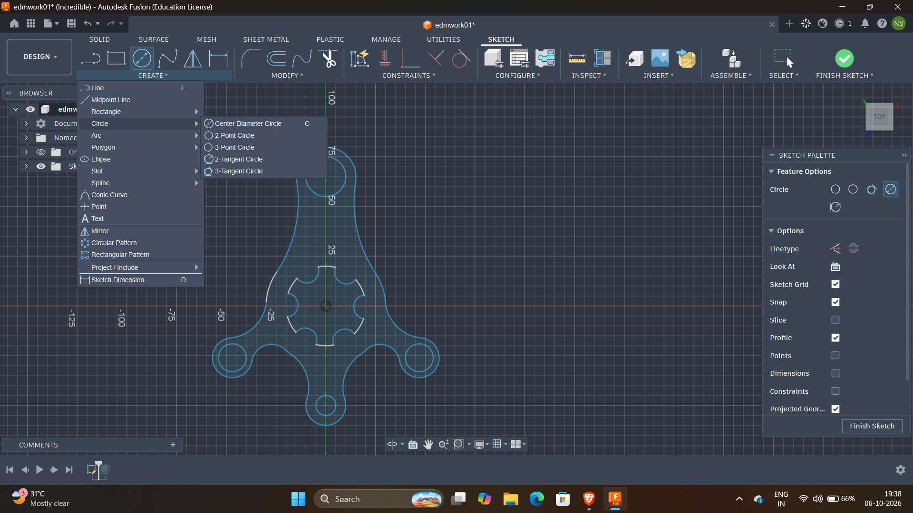
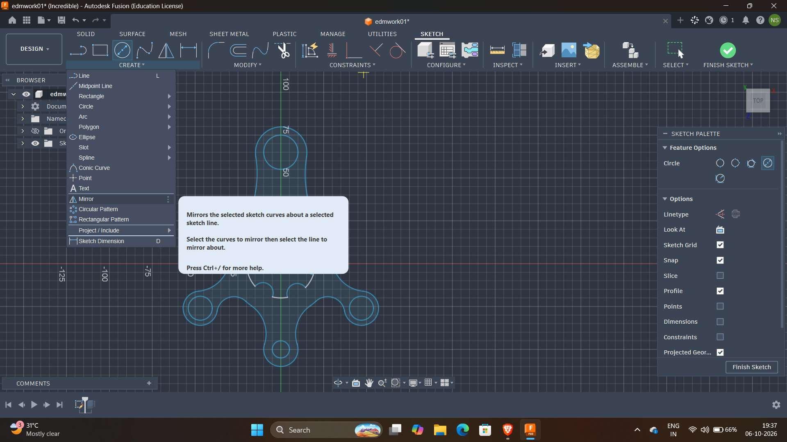
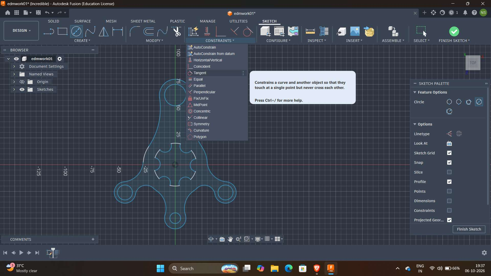
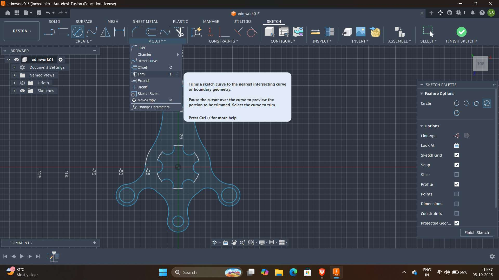
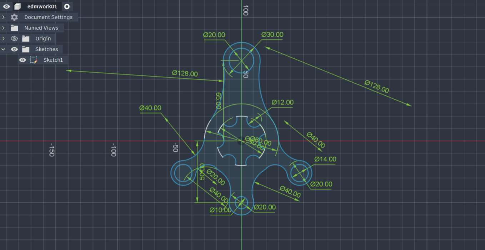
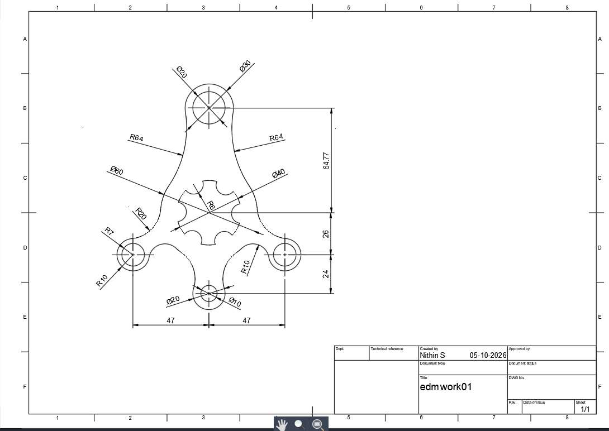

# Ex. No. 1.1 – Design and Draft the Given 2D Sketches in Modelling Software

## Aim
To sketch the given drawing with dimensions using Autodesk Fusion 360.

## Requirements
1. Autodesk Fusion 360
2. Windows 10
3. 16 GB RAM (integrated graphics recommend 2 GB or more)
4. Internet connection: 2.5 Mbps or faster download; 500 Kbps or faster upload

## Procedure

### 1. Create a New Sketch
- Open Autodesk Fusion 360 and create a new design.
- Select **Create Sketch** from the Design workspace.
- Choose the **XY Plane** as the sketch plane.
- Enter the sketching environment and set a suitable view.
- Keep the origin and centre lines visible for reference.

### 2. Mark the Reference Centres
- Take the centre of the main circular feature as the origin.
- Mark the centre of the upper circular feature 65 mm above the origin.
- Mark the centre of the lower circular feature 50 mm below the origin.
- Mark the centres of the left and right side features 26 mm below the origin and 47 mm from the Y-axis.

### 3. Create the Main Circular Features
- At the origin, draw the Ø40 circle.
- Create the required R6 circular features inside the Ø40 circle.
- Use the **Mirror/Pattern** command to create the symmetrical inner features.
- Draw the Ø66 circle with the origin as its centre.
- At the upper centre point, draw the Ø20 and Ø32 circles.
- At the lower centre point, draw the Ø10 and Ø20 circles.
- At both the left and right side centre points, draw the R7/Ø14 and R10/Ø20 circles.

### 4. Complete the Inner Features
- Create the required inner curved features around the Ø40 circle.
- Apply the R6/Ø12 dimension to the required inner curves.
- Use the **Mirror/Pattern** command to obtain the remaining symmetrical features.
- Ensure that all inner features are properly aligned with the centre lines.

### 5. Construct the Outer Profile
- Create the required arcs to connect the circular features and form the outer profile.
- Apply the specified R64/Ø128, R20/Ø40 and R10/Ø20 dimensions to the required arcs.
- Use **Tangent** constraints to smoothly connect the circles and arcs.
- Use the **Mirror** command for the required symmetrical geometry.
- Check that the outer profile is smooth, continuous and symmetrical.

### 6. Trim and Modify
- Select the **Trim** command under Modify.
- Remove unwanted portions of overlapping circles, lines and arcs.
- Repeat the trimming wherever necessary to obtain the required profile.
- Check that no unwanted or incomplete geometry remains.
- Verify the dimensions and constraints as given.

### 7. Final Verification
- Compare the completed sketch with the given drawing.
- Verify all required dimensions, positions, tangencies and symmetry.
- Ensure that the tangent connections are smooth.
- Check that the complete outer and inner profiles are properly formed.
- Click **Finish Sketch** to complete the 2D sketch.

## Output

### Final Sketch in Autodesk Fusion 360

### Dimensioned 2D Drawing

## Result
The given diagram was successfully sketched using Autodesk Fusion 360 with the specified dimensions, geometric features, constraints and symmetry.
